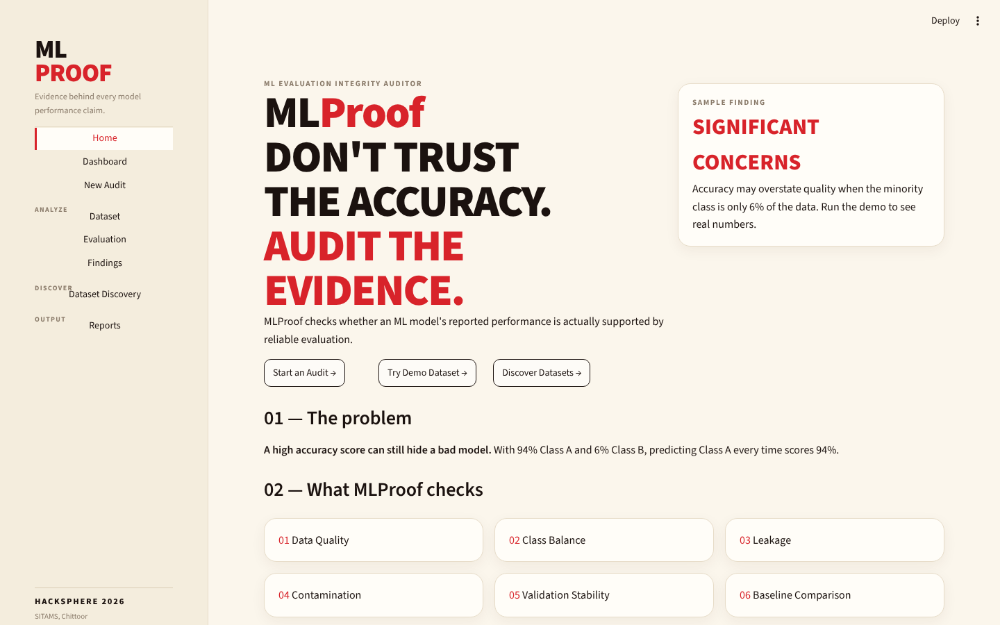
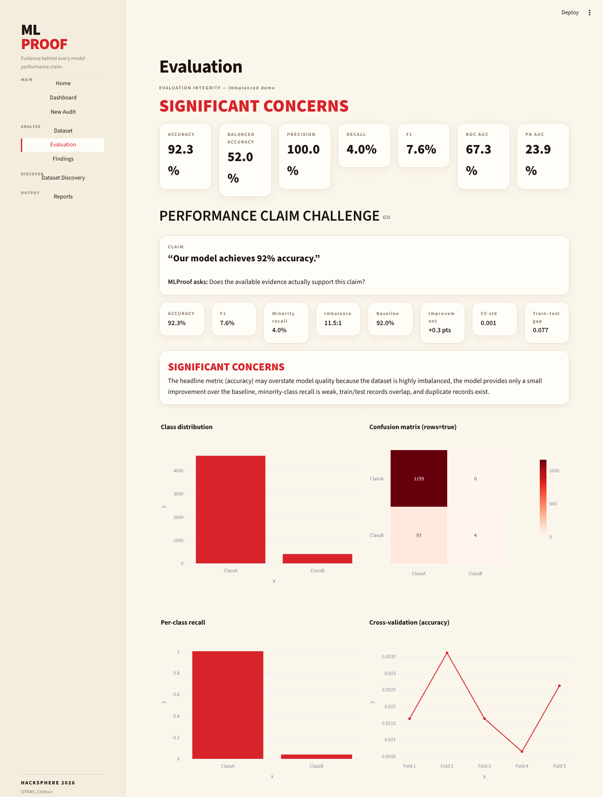
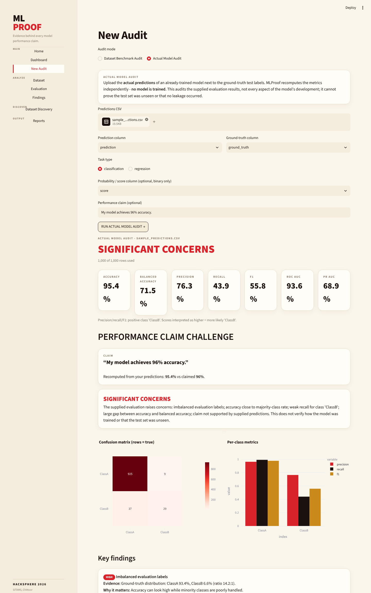
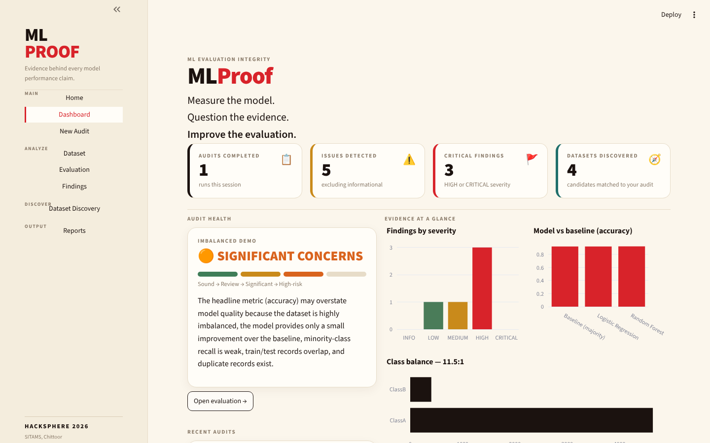
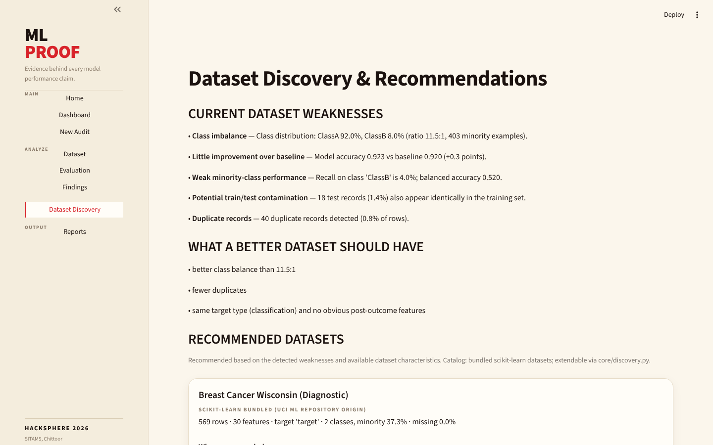

# MLProof — ML Evaluation Integrity Auditor

> Train, Compare, and Verify Machine Learning Models.”

MLProof is a Streamlit application that checks whether a machine-learning model's reported performance is supported by the evidence behind it. A headline number such as "96% accuracy" can be misleading, for example when 94% of the test labels belong to one class. MLProof recomputes the metrics, looks for common evaluation problems, and explains what it finds in plain language.

Built for **HACKSPHERE 2026** (SITAMS, Chittoor) · Domain 8 — Open Innovation.



## The problem

Accuracy on its own can hide a poor model. If 94% of test examples are Class A, a model that always predicts Class A scores 94% accuracy while detecting none of Class B. Students, reviewers and small teams often see only the headline metric, and checking the evidence behind it normally means writing code with a testing library.

## What it does

MLProof has two audit modes.

**1. Dataset Benchmark Audit** — offers two views:

- **Guided workflow** (default): *Upload → Analyze → Clean → Train → Compare → Export*. Upload a CSV and inspect it, review data-quality findings, optionally build a separate cleaned copy, train and compare models on one shared train/test split, then download the results. Details below.
- **Quick integrity audit**: the original one-click audit. Upload a labelled CSV (or use a built-in demo). MLProof trains simple reference models and reports:

| Area | What is checked |
|---|---|
| Data quality | Missing values, duplicate rows, constant / near-constant and ID-like columns |
| Class balance | Class distribution and imbalance ratio |
| Leakage (heuristic) | Suspicious feature names, near-perfect correlation with the target — reported as *potential* leakage, never as confirmed |
| Contamination | Identical records appearing in both the training and test split |
| Performance | Accuracy, balanced accuracy, precision, recall, F1, ROC-AUC, PR-AUC, confusion matrix (classification); MAE, MSE, RMSE, R² (regression) |
| Baseline | Comparison against a trivial baseline (majority class / mean) |
| Stability | 5-fold cross-validation spread |
| Overfitting | Train vs test gap |

### Guided workflow (Model 1)

| Step | What it does |
|---|---|
| Upload | CSV upload (or a built-in messy sample), preview, rows, columns, data types |
| Analyze | Missing values, duplicate rows, constant columns, ID-like columns, numeric / categorical columns, distributions, IQR outliers, target class distribution and imbalance |
| Clean (optional) | Remove duplicates, constant columns, ID-like columns, sparse columns or rows with missing values. Produces a separate cleaned copy with a before/after summary and action log. The original is never changed and the target column is never dropped |
| Train | Task is suggested (classification / regression) and can be overridden. Choose from the six model options listed in [Supported Machine Learning Models](#supported-machine-learning-models); optional TabNet (classification and regression) is off by default and appears only if its packages are installed |
| Compare | Classification: accuracy, precision, recall, F1, balanced accuracy, confusion matrix, per-class metrics. Regression: MAE, RMSE, R² (no accuracy). Comparison table, charts, per-model detail view, plain-language explanation, and a warning when accuracy may be misleading because of class imbalance |
| Export | Cleaned CSV, comparison CSV, and a summary report (PDF / JSON) with dataset findings, cleaning actions, model settings and metrics |

How leakage is avoided: all imputation, scaling and encoding are fitted on the training split only, inside a scikit-learn Pipeline, and every model uses the same split. Cleaning only performs steps that do not use label or test statistics (removing duplicates, constant / ID / sparse columns, or rows). Missing-value filling is applied at training time, not during cleaning. All models are wrapped in the same pipeline and evaluated on the same test rows. A model whose package is missing, or that fails on your data, is reported as skipped and the others still run. Metrics are results of one evaluation on one split, not guarantees of future performance.

**2. Actual Model Audit** — upload the predictions of an already-trained model next to the ground-truth labels, optionally with a score column and a performance claim (for example "My model achieves 96% accuracy."). MLProof recomputes the metrics independently and compares them with the claim. No model is trained in this mode. It audits the supplied evaluation results only; it cannot show that the test set was unseen or that the original training process was valid.

Both modes produce severity-rated findings (INFO → CRITICAL) with evidence, why it matters, and a recommendation, plus a final status: **Relatively sound**, **Review recommended**, **Significant concerns** or **High-risk evaluation**. There is no single "trust score".

**Dataset Discovery** suggests alternative datasets from a small built-in catalogue (scikit-learn's bundled datasets) based on the weaknesses found, shows the reasons for each suggestion, lets you compare it with the current data, and re-runs the audit on it.

**Reports** — PDF and JSON export for both modes.

## Key Advantages

- **No-Code Model Training:** Upload a dataset, select a target column, train machine learning models and evaluate the results directly in the interface, without writing any code.
- **Multi-Model Comparison:** Train and compare multiple models on the same train/test split, so differences in performance reflect the models rather than the data split.
- **Easy Dataset Analysis:** Inspect dataset structure, missing values, duplicate rows, constant and ID-like columns, and other data-quality issues before training.
- **Optional Data Cleaning:** Create a separate cleaned copy of your dataset with a before/after summary and action log. The original data is preserved and the target column is never dropped.
- **Task-Specific Evaluation:** Classification and regression models are evaluated with metrics suited to each task (for example, balanced accuracy and a confusion matrix for classification; MAE, RMSE and R² for regression).
- **Model Reliability Auditing:** Integrity checks, severity-rated findings and downloadable PDF / JSON reports help you judge whether a reported result is actually supported by the evidence.

## Supported Machine Learning Models

The guided workflow offers six main model choices. The task (classification or regression) is suggested from the target column and can be overridden, and each choice maps to the matching model type:


| Model | Classification | Regression |
|---|---|---|
| Logistic / Linear Regression | Logistic Regression | Linear Regression |
| Decision Tree | Decision Tree Classifier | Decision Tree Regressor |
| Random Forest | Random Forest Classifier | Random Forest Regressor |
| XGBoost | XGBClassifier | XGBRegressor |
| CatBoost | CatBoostClassifier | CatBoostRegressor |
| Dummy Baseline | DummyClassifier | DummyRegressor |

All models are wrapped in the same scikit-learn Pipeline and evaluated on the same test rows. The Dummy Baseline is a trivial reference (majority class / mean) that shows what a model must beat to add real value. Models use fixed, simple settings, with depth, tree count and boosting rounds editable. A model whose package is missing, or that fails on your data, is reported as skipped and the others still run.

 


**Metrics used to compare models**

- **Classification:** accuracy, precision, recall, F1-score, balanced accuracy and confusion matrix (plus per-class metrics).
- **Regression:** MAE, RMSE and R².


**Optional advanced model: TabNet.** TabNet (classification and regression) is documented separately because it needs additional dependencies (PyTorch and `pytorch-tabnet`, listed in `requirements-optional.txt`). It is **not enabled by default** and appears in the workflow only if those packages are installed. See [Setup](#setup) for installation. TabNet is slow on CPU and, like any model, may score below simpler models on small tabular datasets.

## Screenshots

| Evaluation | Actual Model Audit |
|---|---|
|  |  |

| Dashboard | Dataset Discovery |
|---|---|
|  |  |

| Model Comparison (Guided workflow) | |
|---|---|
|  | |

## Technology stack

- **Language / UI:** Python 3, Streamlit
- **Data and ML:** pandas, NumPy, scikit-learn (Logistic / Linear Regression, Decision Tree, Random Forest, XGBoost, CatBoost, dummy baselines; optional TabNet)
- **Charts:** Plotly
- **Reports:** ReportLab (PDF), JSON
- **Deployment:** Streamlit Community Cloud
- No external API, LLM or API key is needed. All results come from classical ML calculations.

## Setup

```bash
git clone https://github.com/Shaik-Saniya67/MLProof.git
cd MLProof
python -m venv .venv && source .venv/bin/activate   # Windows: .venv\Scripts\activate
pip install -r requirements.txt
requirements-optional.txt  Optional TabNet packages (torch, pytorch-tabnet)
streamlit run app.py
```

Then open http://localhost:8501.

**Optional - TabNet:** TabNet needs PyTorch, which is large, so it is not in `requirements.txt`. To enable it: `pip install -r requirements-optional.txt`. Without it, MLProof shows TabNet as unavailable and everything else works.

## Usage

1. **Quick look:** on Home, click **Try Demo Dataset**. This audits a built-in imbalanced dataset (about 94% / 6%) and opens the Evaluation page.
2. **Your own data:** go to **New Audit**, choose *Dataset Benchmark Audit*, upload a CSV, select the target column and run the audit.
3. **Guided workflow:** under *Dataset Benchmark Audit* keep the *Guided workflow* view, upload a CSV or pick a built-in sample, then follow the six steps.
4. **Existing model:** choose *Actual Model Audit*, upload a CSV with a prediction column and a ground-truth column, optionally add a score column and a claim. A sample file is provided at `demo_data/sample_predictions.csv`.
5. Review **Findings**, then **Dataset Discovery** for alternatives, and download results from **Reports**.

## Project structure

```
app.py                    Streamlit app (navigation, pages, styling)
core/audit.py             Quick integrity audit engine
core/workflow.py          Guided workflow engine (analysis, cleaning, training, metrics)
core/workflow_ui.py       Guided workflow pages
core/actual_audit.py      Actual Model Audit engine
core/actual_ui.py         Actual Model Audit page
core/discovery.py         Dataset catalogue, ranking reasons
core/demo.py              Demo dataset generators
reports/report_generator.py  PDF / JSON export (audits)
reports/workflow_report.py   PDF / JSON summary for the guided workflow
demo_data/                Sample predictions file
.streamlit/config.toml    Theme
```

## Limitations

- The leakage and contamination checks are heuristics. They can raise a flag for review; they cannot confirm leakage.
- Actual Model Audit works only from the supplied predictions and labels.
- The dataset catalogue is small (bundled scikit-learn datasets), so suggestions are examples of the approach rather than a broad search.
- Guided workflow: outliers are reported but not treated; no ROC-AUC, class weighting or hyperparameter search; models use fixed, simple settings (editable depth / tree count / boosting rounds). TabNet is slow on CPU and, like any model, may score below simpler models on small tabular data; no model is guaranteed to rank first.
- Datasets above 50,000 rows are sampled. Uploaded data is processed in memory during the session and is not stored, but a public deployment should not be used with sensitive data.
- MLProof is not a replacement for full ML testing and monitoring tools; it focuses on one question: is the reported performance supported?

## AI usage disclosure

This project was developed with the help of an AI coding assistant (Claude) for architecture, code, debugging, testing and documentation. The application itself does not call any AI model. The author is responsible for the final project.

## Author

Shaik — B.Tech CSE , SITAMS, Chittoor · [GitHub](https://github.com/Shaik-Saniya67)
